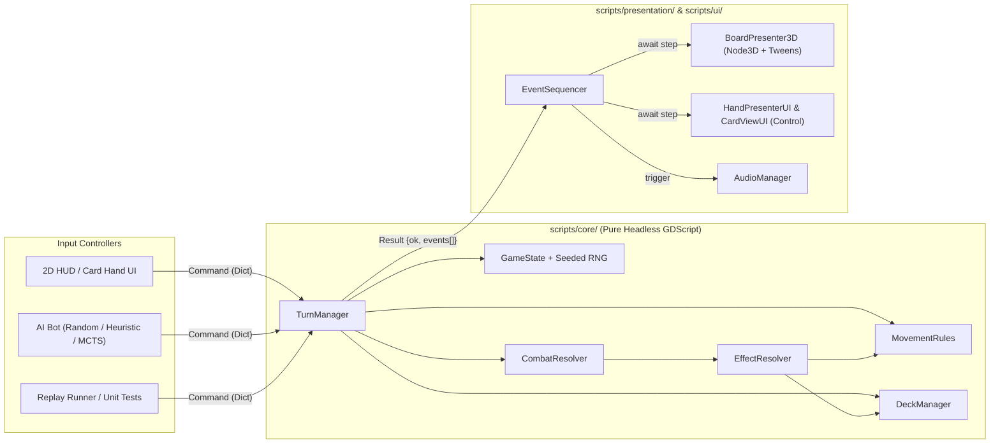

# System Architecture — Headless Core & Presentation Separation

## 1. Architectural Overview

The project enforces a strict unidirectional data flow: **Controllers (UI / AI / Replay)** emit plain Dictionary **Commands** to the **Headless Game Core**, which validates rules, mutates `GameState`, and returns an ordered array of **Domain Events** for the **Presentation Layer** (`Node3D` & `Control`) to animate sequentially.

---

## 2. Headless Game Core (`scripts/core/`)

All classes in `scripts/core/` extend `RefCounted`. They contain **zero** references to `Node`, `Node3D`, `Control`, `SceneTree`, or visual assets, enabling:
1. Sub-millisecond execution in CLI unit tests (`godot --headless -s tests/run_tests.gd`).
2. Zero-overhead state cloning (`state.clone()`) for thousands of Monte Carlo AI simulations per second.

### 2.1. `GameState` (`scripts/core/game_state.gd`)
Holds the complete, serializable snapshot of a match:
- `seed: int` & `rng: RandomNumberGenerator` (storing/restoring `rng.state` on clone).
- `turn_number: int`, `active_player_id: int` (`0` or `1`), `actions_remaining: int` (`0`–`2`).
- `phase: String`:
  - `"START_OF_TURN"` — Optional start-of-turn passive prompt (e.g., Medusa's *Gorgon Gaze*).
  - `"TURN_ACTION"` — Waiting for active player to choose `Maneuver`, `Scheme`, or `Attack`.
  - `"MANEUVER_MOVE"` — Active player moving friendly fighters after drawing/boosting.
  - `"COMBAT_DEFENSE_SELECT"` — Waiting for defender to play a defense card or pass.
  - `"PENDING_CHOICE"` — Waiting for a player to resolve a mid-effect choice (e.g., target space for a push/move, or card to discard).
  - `"END_TURN_DISCARD"` — Active player discarding down to 7 cards.
  - `"GAME_OVER"` — Match concluded (`winner_player_id` set).
- `map_graph: Dictionary` — Loaded battlefield graph (spaces, adjacencies, zones).
- `fighters: Dictionary` — `fighter_id -> { id, owner_id, is_hero, hp, max_hp, move_range, attack_type, space_id, started_turn_space_id }`.
- `players: Dictionary` — `player_id -> { id, hero_id, deck: Array[String], hand: Array[String], discard: Array[String] }`.
- `pending_combat: Dictionary` — Active combat context (`attacker_id`, `defender_id`, `attack_card_id`, `boost_card_id`, `defense_card_id`, `attacker_effects_cancelled`, `defender_effects_cancelled`, `attack_Modifier`, `defense_modifier`).
- `pending_choice: Dictionary` — Context for interactive effect choices (`player_id`, `choice_type`, `valid_options`, `continuation`).
- `command_log: Array[Dictionary]` — Complete history of executed commands for deterministic replay export.

### 2.2. `TurnManager` (`scripts/core/turn_manager.gd`)
The single public gateway to mutate `GameState`:
- `execute_command(state: GameState, cmd: Dictionary) -> Dictionary`:
  - Validates that `cmd.type` is legal in `state.phase` and `cmd.player_id` has authority.
  - Dispatches to `MovementRules`, `DeckManager`, `CombatResolver`, or `EffectResolver`.
  - Appends `cmd` to `state.command_log`.
  - Checks hero defeat after every state transition (`_check_victory(state, events)`).
  - Returns `{ "ok": true, "events": events }` or `{ "ok": false, "error": "Reason", "events": [] }`.
- `get_legal_commands(state: GameState, player_id: int) -> Array[Dictionary]`:
  - Generates all valid commands for the specified player in the current `state.phase`. Used by both UI (for highlighting valid actions/targets) and AI bots.

### 2.3. `MovementRules` (`scripts/core/movement_rules.gd`)
Pure graph queries on `state.map_graph`:
- `get_reachable_spaces(state: GameState, fighter_id: String, max_steps: int) -> Dictionary`:
  - Runs Breadth-First Search (BFS) from the fighter's current `space_id`.
  - **Enemy Blocking:** Spaces occupied by an enemy fighter cannot be entered or passed through.
  - **Friendly Pass-Through:** Spaces occupied by a friendly fighter can be traversed (`steps + 1`), but cannot be selected as a final destination (`space_id != current_space_id` must be empty).
  - Returns `space_id -> shortest_path_array` so the 3D presentation layer knows the exact hop-by-hop path for `Tween` animations.
- `is_valid_attack_target(state: GameState, attacker_id: String, defender_id: String) -> bool`:
  - If `MELEE`: returns `defender.space_id in map_spaces[attacker.space_id].adjacent_ids`.
  - If `RANGED`: returns true if adjacent **OR** if `map_spaces[attacker.space_id].zones` and `map_spaces[defender.space_id].zones` share at least one zone string.

### 2.4. `DeckManager` (`scripts/core/deck_manager.gd`)
Manages cards and deterministic shuffling:
- `shuffle_deck(state: GameState, player_id: int) -> void`:
  - Uses deterministic Fisher-Yates shuffle driven solely by `state.rng.randi_range(0, i)`.
- `draw_cards(state: GameState, player_id: int, count: int, events: Array) -> void`:
  - Draws up to `count` cards one at a time.
  - **Fatigue Handling:** For each draw attempted when `deck.is_empty()`, emits `FatigueDamageDealt` and inflicts `2` damage to every living fighter owned by `player_id`.
- `discard_card(state: GameState, player_id: int, card_id: String, events: Array) -> void`:
  - Removes one instance of `card_id` from `hand` (or active slot) and appends it to `discard`.

### 2.5. `CombatResolver` (`scripts/core/combat_resolver.gd`)
Executes the Unmatched combat state machine:
1. `start_combat(state, attacker_id, defender_id, attack_card_id, optional_boost_card_id, events)` -> transitions to `"COMBAT_DEFENSE_SELECT"`.
2. `submit_defense(state, defense_card_id_or_empty, events)`:
   - Emits `CardsRevealed`.
   - Executes Phase 1 (`IMMEDIATELY`), Phase 2 (`DURING_COMBAT`), Combat Damage Calculation, Victory Check, Phase 3 (`AFTER_COMBAT`), and Discard Cleanup.
   - Strictly enforces **Defender first, Attacker second** trigger ordering in every phase.
   - If any trigger requires player input (e.g., `"MOVE_FIGHTER"` up to 2 spaces or `"PUSH_OPPONENT"` up to 3 spaces), pauses resolution in `"PENDING_CHOICE"` with a lightweight continuation cursor and resumes seamlessly once `ResolveChoice` is submitted.

### 2.6. `EffectResolver` (`scripts/core/effect_resolver.gd`)
Interprets declarative JSON effect arrays without hardcoded card classes:
- **Supported Condition Predicates:** `ALWAYS`, `IF_WON_COMBAT`, `IF_LOST_COMBAT`, `IF_DEALT_COMBAT_DAMAGE`, `IF_ADJACENT`, `IF_SAME_ZONE`, `IF_STARTED_TURN_IN_DIFFERENT_SPACE`.
- **Supported Atomic Operations (`op`):**
  - `CANCEL_ENEMY_EFFECTS` (Feint — cancels opponent's remaining `IMMEDIATELY`, `DURING_COMBAT`, and `AFTER_COMBAT` triggers).
  - `IGNORE_ENEMY_VALUE` (sets opponent's printed card `value` to `0`).
  - `SET_CARD_VALUE` / `ADD_CARD_VALUE` (modifies active combat card strength, optionally scaled by a dynamic counter such as `BOOST_OF_OPPONENT_CARD` or `ZONES_IN_SPACE`).
  - `BLIND_BOOST` (discards top card of deck and adds its `boost` value to combat strength).
  - `DEAL_DAMAGE` (direct non-combat damage to target fighter or all enemy fighters in zone/adjacent).
  - `HEAL_FIGHTER` (restores HP up to `max_hp`).
  - `DRAW_CARDS` (mandatory or optional draw `N`).
  - `MOVE_FIGHTER` / `PUSH_FIGHTER` (queues `"PENDING_CHOICE"` with reachable spaces from `MovementRules`).
  - `DISCARD_CARDS` (opponent or self discards random or chosen card).
  - `GAIN_ACTION` (increments `state.actions_remaining`).
  - `RETURN_DEFEATED_SIDEKICK` (places a defeated 1-HP sidekick token into an empty space in the hero's zone).

---

## 3. Event Bus & Presentation Layer (`scripts/presentation/` & `scripts/ui/`)

Instead of tightly coupling `GameCore` to global Godot signals, `GameController` (`scripts/presentation/game_controller.gd`) owns the authoritative `GameState` instance and feeds returned event arrays into `EventSequencer`.

### 3.1. `EventSequencer` (`scripts/presentation/event_sequencer.gd`)
- Maintains an async queue of `Dictionary` events emitted by `TurnManager.execute_command()`.
- Locks human UI input while animations are playing (`is_animating = true`), plays each event's visual handler (`await board_presenter.play_event(ev)` / `await ui_presenter.play_event(ev)`), and unlocks UI (or triggers the next AI step) when the queue drains.
- **Instant Fast-Forward:** In headless tests or MCTS simulations, `EventSequencer` is bypassed completely.

### 3.2. `BoardPresenter3D` (`scripts/presentation/board_presenter_3d.gd`)
- Reads `data/battlefields/<map>.json` on load and instantiates space discs, zone color segments, and adjacency lines at their 3D `(x, y, z)` coordinates.
- Animates fighter `Node3D` tokens using lightweight Godot `Tween` calls:
  - `UnitMoved`: Parabolic hop (`Tween` on `position.x/z` linear + `position.y` sine arc) from space to space along `path`.
  - `CombatDeclared` / `CombatDamageDealt`: Rapid lunge toward target space, camera/token shake on impact, floating damage number, and `GPUParticles3D` burst.
  - `FighterDefeated`: Tilt-and-sink or dissolve animation before freeing token.

### 3.3. Programmatic Card UI (`scripts/ui/card_view_ui.gd`)
- A reusable `Control` scene (`scenes/ui/card_view.tscn`) composed of:
  - `ArtTextureRect` (displays clean 1K square/portrait illustration from `assets/textures/cards/`).
  - `FramePanel` (tinted procedurally by card type: Red `ATTACK`, Blue `DEFENSE`, Purple `VERSATILE`, Yellow `SCHEME`).
  - `ValueBadge` (`Label` showing printed `value` + type icon).
  - `CharacterBanner` (`Label` showing `"ARTHUR"`, `"MERLIN"`, `"ANY"`, etc.).
  - `BoostCircle` (`Label` showing `+boost` value on the side border).
  - `RulesRichTextLabel` (formats trigger headers like **[IMMEDIATELY]**, **[DURING COMBAT]**, **[AFTER COMBAT]** in bold above effect description text).

