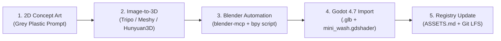

# 3D Asset & Shader Pipeline (`docs/ASSET_PIPELINE.md`)

> **Target Hardware Constraint:** All visual assets must run smoothly on **4 GB VRAM** GPUs at 1080p/60fps. We achieve the tactile *Unmatched* miniature look using low-poly decimated meshes, vertex/1K Ambient Occlusion cavity maps, and a procedural **Mini-Wash Shader** instead of heavy per-character 4K PBR texture sets.

---

## 1. End-to-End Miniature Pipeline Overview



---

## 2. Step-by-Step Workflow

### Step 1: 2D Grey-Plastic Concept Generation
Text-to-3D directly from prompts often produces noisy geometry or baked lighting errors. Always generate a clean 2D reference image first (using ComfyUI with Flux/SDXL or Imagen 3):

- **Mandatory Prompt Template:**
  ```text
  unpainted matte grey plastic board game miniature of <CHARACTER DESCRIPTION>, dynamic heroic tabletop pose, standing on a thick flat circular plastic base, pronounced sculpted folds and deep crevices, front three-quarter view, neutral diffuse studio lighting, pure solid white background, no text, no shadows on background
  ```
- **Why this works:** High-contrast sculpted crevices on matte grey plastic give Image-to-3D models clean depth cues without confusing specular highlights or painted textures with geometry.

### Step 2: Image-to-3D Conversion
Feed the 2D concept image into an Image-to-3D generator (**Tripo 3D** for hero characters, **Meshy** for props, or **Hunyuan3D-2**):
- Export format: `.glb` (binary glTF 2.0).
- Save raw output to a scratch staging folder before running the Blender cleanup script.
- Immediately log the generator name, version, date, and subscription tier in [ASSETS.md](../ASSETS.md).

### Step 3: Automated Blender Cleanup (`blender-mcp` + Python `bpy`)
AI-generated meshes typically have 50k–200k triangles, inconsistent scale, off-center pivots, and uneven bases. Use `blender-mcp` to run a standardized `bpy` processing script (`scripts/tools/process_miniature.py`) that performs:

1. **Scale & Origin Normalization:**
   - Scale the mesh so total height is `1.0` Godot unit (`1.0m` in Godot = `35mm` tabletop scale).
   - Center bounding box on `X/Z` and snap minimum `Y` (`Z` in Blender) to `(0, 0, 0)`.
2. **Standardized Circular Base:**
   - Boolean-union or snap a clean cylindrical tabletop base (`radius = 0.35`, `height = 0.06`, 32 segments) at `(0, 0, 0)` so every miniature stands flat on board spaces.
3. **Polygon Decimation:**
   - Apply `DECIMATE` modifier (`COLLAPSE`) to bring total triangle count under **12,000–15,000 tris** for Heroes (`< 1,500 tris` for Sidekick tokens).
   - Recalculate outside normals (`bpy.ops.mesh.normals_make_consistent(inside=False)`) and enable Auto Smooth.
4. **Cavity / Ambient Occlusion Baking:**
   - Compute mesh dirt/cavity into **Vertex Colors (`COLOR_0`)** via `bpy.ops.paint.vertex_color_dirt()` (or bake a single `1024x1024` grayscale Ambient Occlusion + Curvature texture where `R = AO`, `G = Curvature/Edge`).
   - Storing AO/Cavity in Vertex Colors (`COLOR_0`) requires **0 bytes of texture VRAM**!
5. **GLB Export:**
   - Export to `assets/models/heroes/<hero_id>.glb` with `+Y Up`, `Apply Modifiers = True`, `Export Vertex Colors = True`, and `Export Materials = Placeholder`.

### Step 3B: Procedural Sidekick Tokens & Health Dials (`bpy`)
Sidekick tokens do not need AI generation. A lightweight Blender Python script generates beveled plastic discs (`radius = 0.30`, `height = 0.08`, `< 600` tris) with a recessed top face where the sidekick's 2D emblem icon is mapped.

---

## 3. Godot Procedural "Mini-Wash" Shader (`assets/shaders/mini_wash.gdshader`)

Physical *Unmatched* miniatures are molded in a signature solid plastic color per hero, dipped in a dark acrylic shadow wash that pools in crevices, and lightly dry-brushed on sharp ridges.

Our custom spatial shader reproduces this exact look in Godot 4.7 using **Vertex Colors (`COLOR.r` = Ambient Occlusion / Dirt, `COLOR.g` = Ridge Curvature)** or an optional 1K mask texture:

```glsl
shader_type spatial;
render_mode diffuse_burley, specular_schlick_ggx;

uniform vec4 base_plastic_color : source_color = vec4(0.78, 0.24, 0.22, 1.0);
uniform vec4 wash_color : source_color = vec4(0.08, 0.05, 0.05, 1.0);
uniform vec4 drybrush_color : source_color = vec4(0.95, 0.85, 0.80, 1.0);

uniform float wash_strength : hint_range(0.0, 2.0) = 1.15;
uniform float wash_Contrast : hint_range(0.5, 4.0) = 2.2;
uniform float drybrush_strength : hint_range(0.0, 1.0) = 0.35;
uniform float plastic_roughness : hint_range(0.1, 1.0) = 0.48;
uniform float rim_tint : hint_range(0.0, 1.0) = 0.15;

void fragment() {
    // COLOR.r stores baked vertex Ambient Occlusion / Cavity (0.0 = deep crevice, 1.0 = exposed)
    float cavity = clamp(pow(COLOR.r, wash_Contrast) * wash_strength, 0.0, 1.0);
    vec3 col = mix(wash_color.rgb, base_plastic_color.rgb, cavity);

    // Subtle edge highlight from normal derivative + fresnel to mimic tabletop dry-brushing
    vec3 n_dx = dFdx(NORMAL);
    vec3 n_dy = dFdy(NORMAL);
    float edge = clamp((length(n_dx) + length(n_dy)) * 3.5, 0.0, 1.0) * cavity;
    float fresnel = pow(1.0 - clamp(dot(NORMAL, VIEW), 0.0, 1.0), 4.0) * rim_tint;

    col = mix(col, drybrush_color.rgb, clamp(edge * drybrush_strength + fresnel, 0.0, 1.0));

    ALBEDO = col;
    // Deep crevices with pooled ink wash are slightly glossier/darker than matte plastic ridges
    ROUGHNESS = mix(plastic_roughness * 0.8, plastic_roughness, cavity);
    METALLIC = 0.0;
}
```

---

## 4. Environment, Card Art & VRAM Budget Summary

| Asset Category | Max Resolution / Polycount | Compression / Format | VRAM Footprint Estimate |
| :--- | :--- | :--- | :--- |
| **Hero Miniatures (2x on board)** | `< 15,000` tris each | `.glb` + Vertex Color AO + `mini_wash.gdshader` | `< 5 MB` total |
| **Sidekick Tokens (up to 4x)** | `< 1,500` tris each | `.glb` + `512x512` emblem icon | `< 2 MB` total |
| **Battlefield Board Surface** | `2048x2048` (Albedo + Normal + Roughness) | Godot `VRAM Compressed` (BPTC/S3TC) | `~16 MB` |
| **Tabletop Wood & Sky HDRI** | `1024x1024` PBR + `1024x512` HDRI | CC0 (Poly Haven) `VRAM Compressed` | `~12 MB` |
| **Card Illustrations (20 unique per deck)** | `1024x1024` clean 2D art (`.webp`) | `VRAM Compressed` (no mipmaps needed for 2D UI) | `~40 MB` |
| **Tabletop Animations** | 0 skeletal bones | Procedural `Tween` arcs, lunges & hit-shakes | `0 MB` |
| **Total Estimated Scene VRAM** | — | Well inside **4 GB VRAM** hardware constraint | **< 250 MB** (incl. Godot framebuffers) |

