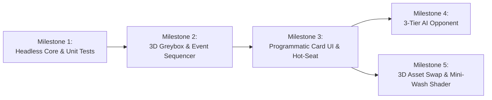

# Development Milestones (`docs/MILESTONES.md`)

Development is organized into 5 sequential milestones. Each milestone has strict acceptance criteria and verification gates before the next milestone begins.

---

## Milestone 1: Headless Game Core & Unit-Tested Rules
**Goal:** Build the complete, deterministic *Unmatched* rules engine in `scripts/core/` and JSON data in `data/` with zero 3D/UI dependencies.

### Deliverables
1. **Project & Git LFS Bootstrap:**
   - `project.godot` (Godot 4.7 config), `.gitattributes` (Git LFS rules for `.glb`, `.png`, `.webp`, `.ogg`, `.wav`), and directory skeleton.
2. **Data Definitions (`data/`):**
   - `data/battlefields/sanctum_courtyard.json` (18-space graph, 4 zones, symmetric adjacencies).
   - `data/heroes/arthur.json` and `data/heroes/medusa.json`.
   - `data/cards/arthur_deck.json` and `data/cards/medusa_deck.json` (30 cards each).
3. **Core Modules (`scripts/core/`):**
   - `game_state.gd` (state snapshot, seeded `RandomNumberGenerator`, `clone()`, state hash).
   - `movement_rules.gd` (BFS pathfinding, friendly pass-through, enemy blocking, melee/ranged zone targeting).
   - `deck_manager.gd` (deterministic shuffle, draw, 2-damage exhaustion/fatigue, discard).
   - `effect_resolver.gd` (`CANCEL_ENEMY_EFFECTS`, value modifiers, `BLIND_BOOST`, direct damage, heal, push/move choices, draw/discard).
   - `combat_resolver.gd` (`IMMEDIATELY` -> `DURING_COMBAT` -> Combat Damage -> `AFTER_COMBAT` with strict **Defender-first** trigger order).
   - `turn_manager.gd` (2-action economy, 7-card end-of-turn hand limit, victory detection, `get_legal_commands()`).
4. **Automated Test Suite (`tests/`):**
   - `tests/run_tests.gd` headless runner executing unit tests for graph invariants, movement blocking, Feint cancellation timing, Arthur boost cancellation edge case, Medusa start-of-turn gaze, fatigue damage, and a full deterministic replay test (`tests/replays/arthur_vs_medusa_seed_42.json`).

### Acceptance Gate
- `godot --headless -s tests/run_tests.gd` exits with code `0` and 100% passing assertions.
- Re-running the same replay seed produces the exact same final state hash.

---

## Milestone 2: 3D Greybox Battlefield & Event Sequencer
**Goal:** Visualize `GameState` on a 3D tabletop using procedural primitives (`CylinderMesh`, `ImmediateMesh` / `MeshInstance3D`) and `Tween` animations driven by domain events.

### Deliverables
1. **`battlefield.tscn` & `BoardPresenter3D`:**
   - Spawns 3D space discs colored by `zones` and connected by adjacency lines from `sanctum_courtyard.json`.
   - Spawns distinct colored cylinders for Heroes (tall cylinder) and Sidekicks (flat disc token) with floating 3D HP labels.
2. **Orbital Tabletop Camera (`CameraController3D`):**
   - Clamped pitch (`25°` to `75°`) so the camera never clips below the table, smooth zoom and orbit around the board center, and raycast space/fighter picking.
3. **`EventSequencer` & Tabletop `Tween` Animations:**
   - Parabolic hop animation along BFS path on `UnitMoved`.
   - Lunge-and-shake animation on `CombatDamageDealt`.
   - Token removal animation on `FighterDefeated`.

### Acceptance Gate
- Launching `scenes/game.tscn` via `godot-mcp` renders the 18-space 3D board, places Arthur, Merlin, Medusa, and 3 Harpies on valid starting spaces, and plays a scripted/simulated turn visually with zero console errors.

---

## Milestone 3: Programmatic Card UI & Local Hot-Seat Match
**Goal:** Build the dynamic 2D `Control` card interface and interactive input controller so two human players can play a complete match from start to finish.

### Deliverables
1. **`CardViewUI` (`scenes/ui/card_view.tscn`):**
   - Renders card frame color (`ATTACK`/`DEFENSE`/`VERSATILE`/`SCHEME`), printed `value`, `boost` circle, `character` banner, and formatted trigger text dynamically from JSON over clean 2D artwork.
2. **`HandPresenterUI` & HUD:**
   - Fanned card hand at the bottom of the screen with hover zoom.
   - Action bar (`Maneuver`, `Scheme`, `Attack`, `Boost`, `End Maneuver`), Turn/Action counter (`2 Actions Left`), Deck/Discard counters, and Hero/Sidekick Health Dials.
3. **Interactive Highlighting & Choice Prompts:**
   - Highlights reachable spaces in green during Maneuver/Move effects and valid attack targets in red during Attack declaration.
   - Modal prompt for Defender card selection (`SelectDefenseCard`) and mid-combat choices (`ResolveChoice`).
   - Victory banner with "Play Again" and "Export Replay Log" buttons.

### Acceptance Gate
- A full 1v1 Local Hot-Seat match can be played from Turn 1 to `GAME_OVER` through mouse clicks alone, verified with screenshots via `godot-mcp`.

---

## Milestone 4: 3-Tier Local AI Opponent
**Goal:** Implement the three AI difficulty levels using `TurnManager.get_legal_commands()` and `GameState.clone()`.

### Deliverables
1. **Tier 1 — `RandomBot` (`scripts/ai/random_bot.gd`):**
   - Selects uniformly among legal commands using a seeded RNG (also used for automated 100-match fuzz testing).
2. **Tier 2 — `HeuristicBot` (`scripts/ai/heuristic_bot.gd`):**
   - Evaluates 1-step lookahead using a weighted board scoring function (Hero HP differential, enemy Sidekick elimination, ranged zone advantage, hand size, saving `DEFENSE` cards when adjacent to enemy).
3. **Tier 3 — `MCTSBot` (`scripts/ai/mcts_bot.gd`):**
   - Clones `GameState`, determinizes the opponent's hidden hand by shuffling unseen cards from the opponent's remaining deck + hand pool, and runs fast headless rollouts within a `150 ms` frame budget.

### Acceptance Gate
- Automated headless test runs 50 matches of `HeuristicBot` vs `RandomBot` (`win_rate >= 75%`) and `MCTSBot` vs `HeuristicBot` with zero crashes or infinite loops.

---

## Milestone 5: 3D Miniature Pipeline, Mini-Wash Shader & Audio Polish
**Goal:** Replace greybox cylinders with stylized 3D miniatures, procedural sidekick tokens, the `mini_wash.gdshader`, tabletop environment textures, and audio.

### Deliverables
1. **3D Models via `blender-mcp`:**
   - `arthur.glb` and `medusa.glb` (`< 15k` tris, circular base, baked vertex AO/cavity).
   - `merlin_token.glb` and `harpy_token.glb` (`< 1,500` tris procedural beveled discs).
2. **Shaders & Materials:**
   - `assets/shaders/mini_wash.gdshader` applied to Hero miniatures with hero theme colors.
   - CC0 wood tabletop and stone board materials (1K–2K VRAM-compressed) + studio HDRI lighting.
3. **Audio & Provenance:**
   - `AudioManager` (`Music`, `SFX`, `UI` buses) with card slide, token hop, attack hit, and background music.
   - All assets verified and documented in `ASSETS.md`.

### Acceptance Gate
- Full match vs. AI runs smoothly within the **4 GB VRAM** budget (`RenderingServer` video memory monitor `< 512 MB`), with all assets logged in `ASSETS.md`.

